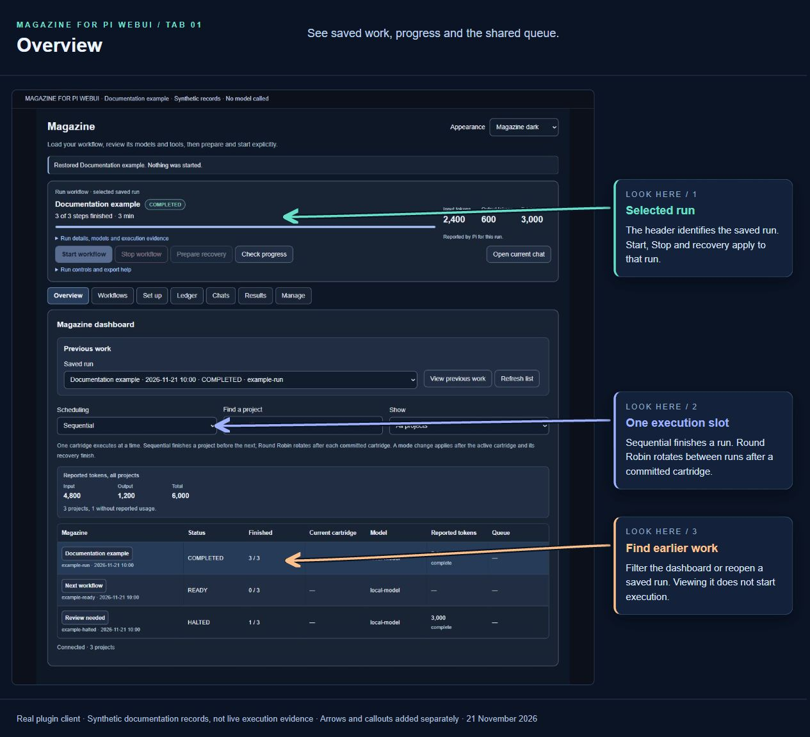

# Magazine for Pi WebUI

**Give your AI one clear job at a time. Keep the results and see what happened.**

Magazine is a plugin for Pi WebUI. It takes a task that you have split into small,
ordered steps and runs them using the models you choose. Each step is called a
**cartridge**. Each attempt gets a fresh, saved conversation, so it does not have
to carry the whole previous chat into the next job.

It is designed to make larger tasks more manageable for smaller models, while
remaining usable with larger models too. It is a prompt sequencer, not an AI
that invents your plan or a promise that a model will get everything right.

*Screenshots show the real Magazine client with safe example records. The models,
results and token figures shown are illustrations, not a live-model benchmark.*

## How you use it

1. Open **Plugins → Magazine** in Pi WebUI.
2. Import a workflow ZIP, or load a valid JSON workflow.
3. Read the steps. Choose a model and only the tools the work needs.
4. Choose **Prepare workflow**. This saves a **READY** run; nothing executes yet.
5. Review it, then choose **Start workflow**.
6. Read the results, inspect the chats and download the records you need.

Use one compatible Pi model throughout, or assign different models to individual
steps. Magazine does not require a particular LLM and does not silently replace
your chosen model. There is no separate Magazine login, owner key or import key.
Pi's own access controls still apply.

## What each tab does

| Tab | What you use it for |
| --- | --- |
| [Overview](docs/VISUAL-GUIDE.md#overview) | Find saved runs, see progress and manage the shared execution queue. |
| [Workflows](docs/VISUAL-GUIDE.md#workflows) | Import and load reusable workflow templates. |
| [Set up](docs/VISUAL-GUIDE.md#set-up) | Review prompts, choose models and tools, then prepare a run. |
| [Ledger](docs/VISUAL-GUIDE.md#ledger) | Inspect each cartridge's attempts, timings, errors and recorded checks. |
| [Chats](docs/VISUAL-GUIDE.md#chats) | Read the actual retained worker conversations and tool records. |
| [Results](docs/VISUAL-GUIDE.md#results) | Inspect committed results and download ZIP or complete-run JSONL exports. |
| [Manage](docs/VISUAL-GUIDE.md#manage) | Manage templates and saved runs separately; restore deleted records from trash. |

**[Read the guide to all seven tabs →](docs/VISUAL-GUIDE.md)**

## What the checks are for

For committed-result workflows, Magazine checks that the saved result belongs to
the right run, step, attempt and session. It checks the publisher's receipt,
required outputs and declared handovers before moving on. A handover is the
specific result or file that a later step needs from an earlier one.

Missing or changed evidence stops progression. Eligible failures can receive
bounded retries; STOP and explicit recovery remain under your control. The
ledger and chats keep the available evidence so you can inspect a problem.

**These checks do not prove that the answer is correct.** A matching file hash
proves that the recorded bytes match, not that the file does the right thing.
Review the deliverables and use real task-specific tests.

**[Technical guide: execution, checks, handovers and safeguards →](docs/TECHNICAL-GUIDE.md)**

## Development status — 24 November 2026

A newer local development build, **0.1.0-pi.9.1**, has been reported after a reliability audit. It adds worker confinement, controller-integrity checks, emergency Stop and explicit damaged-state repair, restore-point management, model-error classification and optional required-path preflight. A follow-up fix addresses Docker Desktop filesystem compatibility.

The local report records 984 passing Python tests (one skipped), 13 passing Node tests and live non-inference checks. Real-model execution under the new sandbox remains unverified. The pi.9.1 source has not yet been synchronised to this repository; these changes are not included in the public source version below.

**[Development roadmap and outstanding work](TODO.md)** — priorities, known limitations, acceptance requirements and the reported local changes.

## Install and compatibility

Current public source version: **0.1.0-pi.8-ui.5**, including automatic Ollama model
discovery and guarded interrupted-run reconciliation.

> **Recommended Pi installation: Pi WebUI 0.120.0 with Pi SDK 1.5.2** (`@earendil-works/pi-coding-agent`). Pin both versions; updating Pi WebUI alone can also change the resolved SDK. The tested Docker Desktop deployment uses Node 22.23.5 and Python 3.11.

| Pi WebUI | Pi SDK | Compatibility status |
| --- | --- | --- |
| **0.120.0** | **1.5.2** | Recommended deployment; tested host/SDK pair |
| 0.115.0 | 1.1.0 | Historical allowlisted pair; offline-verified, not current acceptance baseline |
| 0.96.1 | 1.0.2 | Historical allowlisted pair; earlier live acceptance |
| 0.122.0 | 1.6.1 | Not supported for the newer confined-worker candidate; local worker-integrity checks failed |
| Other combinations | Any | Unverified unless explicitly covered by the installed release's compatibility matrix |

Newer development candidates (including pi.10.4) are being validated on the recommended pair. Their worker confinement also relies on SDK-specific shell-tool behaviour; a compatibility override does not establish worker safety. Do not bypass these checks or assume newer Pi/SDK releases are supported. The candidate code is not part of the public source version above.

See the [installation guide and version verification commands](docs/INSTALL.md#requirements) before installing or upgrading. This is the WebUI plugin, not the separate Pi CLI or Magazine for Open WebUI.

Start with [installation](docs/INSTALL.md). Docker Desktop users should also read
[Linux storage and safe migration](docs/LINUX-STORAGE.md): Magazine's internal
state needs the supported atomic file operations. Keep backups and update only
when Magazine is idle. Never remove a current data mount and assume the older
directory underneath it contains your latest work.

This repository contains the complete source; it does not currently offer a
published GitHub Release with prebuilt downloads. Packaging instructions are in
the installation guide. Documentation screenshots are not plugin runtime assets.

## More detail

- [Technical guide and source map](docs/TECHNICAL-GUIDE.md)
- [Automatic Ollama model discovery](docs/AUTOMATIC-MODELS.md)
- [Restart recovery and reconciliation](docs/RESTART-RECOVERY.md)
- [Restart-repair validation: 929 passed, 1 legacy skip](docs/RESTART-RECOVERY-ACCEPTANCE.md)
- [Earlier import repair and real-model qualifications](docs/IMPORT-REPAIR.md)
- [Test methods and historical results](docs/TESTING.md)
- [Security and tool authority](docs/SECURITY.md)
- [Model selection and JSONL format](docs/MODELS-AND-JSONL.md)

MIT licensed. No Open WebUI service is required or changed by this plugin.
