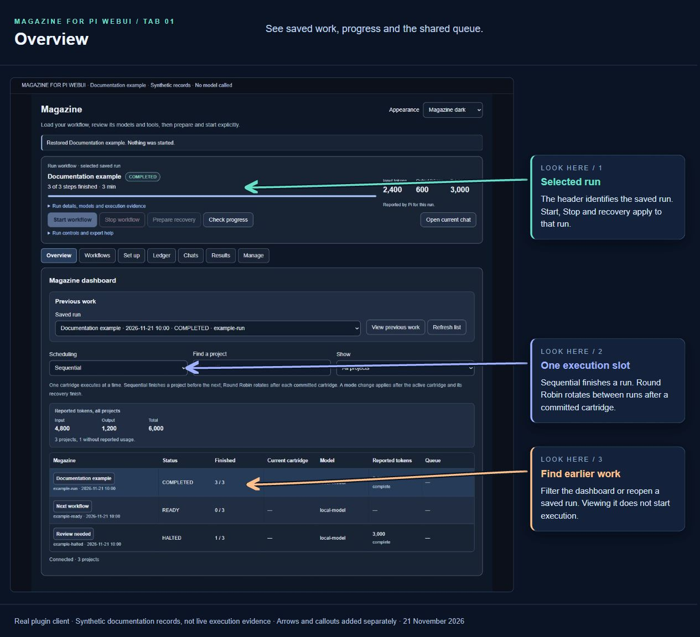

# Magazine: a guide to the seven tabs

This guide follows the current **0.1.0-pi.8-ui.3** client, including the simple
deletion confirmations added on 21 November 2026. Open **Plugins → Magazine**
in your existing Pi WebUI installation.

The Overview image is a capture of the real client, displayed with synthetic example
records in a read-only documentation preview. No model was called and no private
run was used. The arrows are separate annotations; the interface inside each
capture has not been redrawn. The preview does not include Pi's surrounding chat
toolbar. Your models, names, dates and figures will differ.

The selected-run header stays available across tabs. It identifies the run to
which Start, Stop, Prepare recovery and Check progress apply. Choosing new setup
values does not change an already prepared run's saved model assignments.

For how these controls work internally, see the [technical guide](TECHNICAL-GUIDE.md).

## Overview

Overview answers three questions: **What is selected? What has happened? What
is waiting?**

- The header names the selected saved run, its status and progress. Expand
  **Run details, models and execution evidence** for exact assignments and
  available execution/control information.
- **Previous work → View previous work** opens an earlier run. Reopening it
  does not start it again.
- The dashboard lists saved runs, finished steps, the current step, model,
  reported tokens and queue position. Search and status filters help with long
  histories. The top token totals cover the listed run collection, not a model
  quality score or measured cost.
- **Sequential** keeps a run's execution slot until it ends. **Round Robin**
  gives another eligible run a turn after a successfully committed cartridge.
  It does not switch models halfway through a response or run two cartridges
  simultaneously within the scheduler.

`READY` means prepared, not executed. `QUEUED` means admitted and waiting.
`HALTED` means the run needs attention; `STOPPED` is not a pause. `COMPLETED`
means the execution contract passed, not that the deliverable is independently
proven correct.

## Workflows

A workflow is a reusable template. A saved run is a particular prepared execution
of that template. You can have several saved runs from the same workflow.

1. Expand **Add a workflow** and select a valid ZIP, then choose **Import ZIP**.
   No Magazine administrator key is needed.
2. Alternatively, open **Use a Magazine JSON document**, paste its supported
   document and choose **Validate document**.
3. Choose an imported workflow and click **Load your workflow** to open its setup.
   Merely choosing a different name is not an instruction to run it.

ZIP import still checks the format, paths, sizes and collisions. Rejection is not
an invitation to rename random files inside the archive until it imports:
inspect the reported error and the [package contract](TECHNICAL-GUIDE.md#workflow-import-and-validation).
The original Input ZIP is retained under the existing import rules.

## Set up

Set up is the review stage before you create a new saved run.

- **Workflow model** chooses from Pi's compatible configured catalogue. It is
  not an Ollama installer or a provider-configuration screen.
- **Assign models per cartridge** lets a step inherit the workflow model or use
  an explicit override. **Apply to selected** changes a selected group in the
  setup. Check the individual assignments before preparation.
- **Workflow steps** preserves the order. Expand a cartridge to read its full
  prompt. Selection checkboxes are used for bulk model assignment; they are
  not a command to omit unchecked cartridges from execution.
- **GPT/Claude suggestions (optional)** builds a reviewable brief for an external
  planner you choose. Magazine sends no automatic external AI request. Review
  sensitive prompts before copying. Pasted JSON must be validated, then explicitly
  applied. Validation alone changes nothing.
- **Tools and protection** controls selected allowed tools, Antiloop and the
  handover mode. No tools are selected by default. A shell tool has real Pi-process
  permissions; the tool list is not a filesystem sandbox.
- **Prepare workflow** freezes a READY run snapshot. It does not call a model.
  Review the selected run, then choose **Start workflow** separately.

The pictured per-step override belongs to a new setup. The completed example
in the header retains its own earlier saved assignments.

## Ledger

Use Ledger when you need to understand **why a particular cartridge passed,
retried or stopped**. The screen shows one cartridge at a time.

Choose it by ID or use **Previous** and **Next**. Inspect its exact model, status,
attempt count, timestamps, recorded duration, reported tokens, completeness
warnings and last failure/retry decision. Expand each attempt to see its own
session identity, output metadata and available handover/recovery fields.

**View in Chats** opens the associated retained conversation. **Verified committed
handover** shows the structured payload separately from the closing reply.
Activity and the exported Markdown ledger are available below.

Missing usage is shown as unavailable or incomplete. A lower token total does
not establish a more efficient model when reporting is incomplete.

## Chats

Chats is the readable conversation history for Magazine workers, including
failed and recovered attempts. It does not list unrelated ordinary Pi chats.

Search or filter by run, model or status. Select an attempt to read the retained
prompt, visible assistant messages, tool calls, arguments, results and errors.
Code remains readable in code blocks. This is a **read-only viewer**: it cannot
send a new prompt or quietly change the model while a worker runs.

**Auto-follow new messages** tracks live records; switch it off or scroll back
to inspect older content. **Load next messages** retrieves more retained records
when available. The viewer omits private typed reasoning and assistant thinking
sections, and applies credential redaction. It does not rewrite the source session.

Chats and JSONL are different views. Complete-run JSONL preserves its broader
retained-record semantics, so review an export before sharing it.

## Results

Results separates the **committed handover** from the **final reply**. For example,
`{"status":"DONE"}` is a closing signal, not a replacement for the output the
workflow was supposed to produce.

- **Download results ZIP** collects the available saved results, ledger and
  committed handover files using the existing export rules.
- **Download Run JSONL** downloads one machine-readable file for the whole
  selected run, not one file per cartridge. It includes all retained attempts and
  their recorded content, subject to retention, consistency checks and redaction.
- **Export Finished Work** creates or retries the existing Finished Work export.
  Its availability and that of the results ZIP depend on run state. Whole-run
  JSONL remains available for retained READY, partial, halted and stopped runs too.

Open the actual files and check the task's acceptance conditions. A committed
payload can contain a model's claim about a test; the claim itself is not an
independent rerun of that test.

## Manage

Manage keeps three things separate: **workflow templates**, **saved runs** and
**recoverable Magazine trash**.

- **Delete template** removes the reusable template from the active library.
  Saved run snapshots, Input ZIPs, exports and actual project files are kept.
- **Delete saved run** retires that run's managed records and Magazine-owned
  run workspace. It keeps the reusable template, Input ZIPs, Finished Work exports
  and actual user project files outside that managed run workspace.
- Deletion presents the named item and **Confirm deletion / Cancel**. No typed
  run ID is required. Active/queued work and unresolved termination are guarded
  on the server too, not just by a disabled button.
- **Restore** returns records from Magazine trash without starting execution.
  It refuses identity collisions rather than overwriting an existing record.

There is no permanent purge or Delete all here. Keep independent backups when
the records matter; trash and exports are not a complete backup strategy.

## If something looks wrong

Check the selected run's ID first: a template and a saved run can share a name.
Read the Ledger decision and the exact attempt in Chats. Export the retained
run before making changes. A model/provider error, a missing output and a
storage failure need different remedies; none is a reason to change Pi's login,
network exposure or model settings blindly.

See [technical safeguards and limits](TECHNICAL-GUIDE.md),
[installation](INSTALL.md) and [the actual acceptance record](IMPORT-REPAIR.md).

## Reconcile interrupted run

In ui.4 the selected-run header also has **Reconcile interrupted run**. It is
enabled only for eligible extinct owners. It persists HALTED without starting
inference. Cancellation and external operation completion remain unconfirmed.
See [restart recovery](RESTART-RECOVERY.md) before preparing recovery or deleting saved work.
